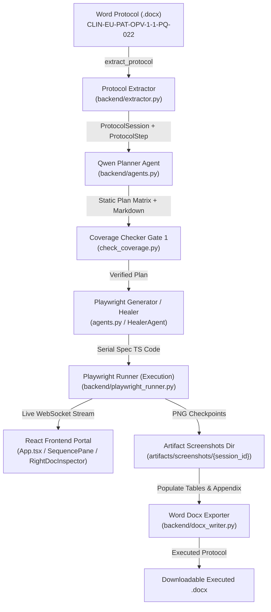
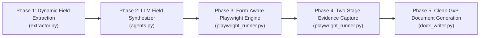

# Architectural & Forensic Audit: OnePV CSV Validation Portal
**System Under Test:** Clinevo OnePV Intake Application (`https://mpv-two.vercel.app`)  
**Protocol Document:** `CLIN-EU-PAT-OPV-1-1-PQ-022 - Manual - Registering Adverse Event Case.docx`  
**Target Environment:** 21 CFR Part 11 / GxP Computer Systems Validation (CSV) Automated Test Suite  

---

## 1. Executive Summary & Purpose

This document provides a complete, forensic architectural review of the automated Computer Systems Validation (CSV) platform. It pinpoints:
1. Every instance of hardcoding across the codebase.
2. The exact disconnect between the Word Protocol requirements, the AI Plan Generator, and the Playwright Execution Agent.
3. Why 75%+ of data fields are skipped and left blank on the live target application.
4. Why screenshots are repetitive, obscured by modals, or missing key form state.
5. A structured, turnkey prompt to feed into **Gemini Argon** to build a robust, phase-by-phase refactoring plan.

---

## 2. Current Architecture (As-Is) & System Pipeline



### Breakdown of Existing Modules:
1. **`extractor.py`**: Reads `.docx` tables using `python-docx`. Parses Step #, Scenario, Procedure, Expected Results, detects `(µ)` screenshot symbols, and classifies each step into an `action_intent` (e.g. `ADD_REPORTER`, `ADD_PATIENT`, `ADD_PRODUCT`, `ADD_EVENT`).
2. **`agents.py` (`PlannerAgent`)**: Generates a test plan. Calls Groq Qwen (`qwen/qwen3.8-27b`) for a high-level text summary, but assigns predefined dictionary structures for step test data.
3. **`playwright_runner.py`**: Launches Chromium via Playwright, streams live JPEG frames over WebSockets to the UI, performs form interactions, dismisses modal dialogs, captures screenshots, and records observed results.
4. **`docx_writer.py`**: Clones the original Word document losslessly, writes "Pass"/"Fail" and timestamps in natural black ink into the protocol tables, embeds micro-evidence screenshots into Column 5, and appends a high-resolution screenshot evidence appendix at the end.
5. **Frontend (`App.tsx`, `MiddleSequencePane.tsx`, `RightDocInspector.tsx`)**: Displays execution timeline, live Playwright canvas stream, step status pills, and interactive Word document viewer.

---

## 3. Forensic Problem Breakdown

### Problem 1: Pervasive Hardcoding Across the Pipeline
The codebase currently relies on static data dictionaries, fixed string literals, and hardcoded selectors rather than dynamically extracting and executing what the protocol specifies.

* **Hardcoded Clinical Test Data in `backend/agents.py` (Lines 67–152):**
  * `LOGIN_ONEPV`: Hardcoded credentials `sirihari.banda` / `Clinevo@2026` / `Clinevo`.
  * `ADD_REPORTER`: Hardcoded only 3 fields: `reporterFirstName: "Siri"`, `reporterLastName: "Hari"`, `countryCode: "US"`.
  * `ADD_PATIENT`: Hardcoded only 2 fields: `patientInitials: "PT-01"`, `gender: "Male"`.
  * `ADD_PRODUCT`: Hardcoded single string: `productName: "Paracetamol 500mg"`.
  * `ADD_EVENT`: Hardcoded 2 fields: `reportedTerm: "Headache"`, `meddraCode: "10019211"`.
  * `ADD_QUESTIONNAIRE_MANUAL`: Hardcoded question: `"Did the patient experience pyrexia or chills?"`.
  * `RESPOND_QUESTIONNAIRE_MANUAL`: Hardcoded answer: `"Patient confirmed mild pyrexia resolved within 24 hours."`.
* **Hardcoded Result Scraping in `backend/playwright_runner.py`:**
  * Step 4: Fixed string `step.observed_result = "Verified: Case ID TMP-CASE-1001 created and General Info saved successfully."` while the live application generated `TMP-CASE-8908` or `TMP-CASE-1244`.
  * Step 15: Fixed string `step.observed_result = "Case submitted successfully. Case ID: CASE-2026-0042 generated."`.
* **Hardcoded Fallbacks in `backend/extractor.py`:**
  * Fallback document metadata: `"CLIN-EU-PAT-OPV-1-1-PQ-022"`, `"01-Oct-2026"`, `"1.0"`.

---

### Problem 2: The Data Extraction & Missing Fields Problem (Protocol vs. Execution Gap)
The Word protocol explicitly details the required fields in the `Procedure` column for every step. However, **`extractor.py` extracts only the high-level intent and discards the field instructions.** Consequently, Playwright only fills 2–3 hardcoded fields, leaving 75%+ of the form controls completely blank.

A DOM inspection of `https://mpv-two.vercel.app/intake/manual-case-registration` proves that **the live application possesses every single one of these input fields and dropdowns**:

#### Case-by-Case Field Comparison:

| Step # & Intent | Protocol Required Fields in Document | Fields Actually Filled by Playwright | Missing / Blank Fields on UI |
| :--- | :--- | :--- | :--- |
| **Step 4: Register Case** (`REGISTER_CASE`) | Case Classification Code, Case Intake Source Code, Company Receipt Date, Processing Center Received Date | Classification, Source, Receipt Date, Processing Date (4/4) | None. (However, Case ID was hardcoded in the log rather than scraped). |
| **Step 5: Add Questionnaire** (`ADD_QUESTIONNAIRE_MANUAL`) | Field Type dropdown, Question text field | Field Type (`Text`), Question (`Did the patient experience pyrexia or chills?`) (2/2) | None. |
| **Step 6: Respond Questionnaire** (`RESPOND_QUESTIONNAIRE_MANUAL`) | Response field in table | Response input (1/1) | None. |
| **Step 9: Add Reporter** (`ADD_REPORTER`) | **16 Fields:**<br/>1. Title<br/>2. First Name<br/>3. Last Name<br/>4. Sex code<br/>5. Relationship With Patient Code<br/>6. Reporter Type code<br/>7. Is Reporter Health Care Professional (toggle)<br/>8. Address1<br/>9. Address2<br/>10. City<br/>11. State<br/>12. Country code<br/>13. Zipcode<br/>14. Fax<br/>15. Contact Number<br/>16. Email Address | **Only 3 fields filled:**<br/>- `First Name` ("Siri")<br/>- `Last Name` ("Hari")<br/>- `Country code` ("United States") | **13 Fields Left Completely Blank:**<br/>- Title (`#title`)<br/>- Sex code (`#reporterSexCode`)<br/>- Relationship (`#relationshipWithPatientCode`)<br/>- Reporter Type (`#reporterTypeCode`)<br/>- HCP toggle (`#isReporterHealthCareProfessional`)<br/>- Address 1 (`#address1`)<br/>- Address 2 (`#address2`)<br/>- City (`#city`)<br/>- State (`#state`)<br/>- Zipcode (`#zipcode`)<br/>- Fax (`#fax`)<br/>- Contact Number (`#contactNumber`)<br/>- Email (`#emailAddress`) |
| **Step 10: Add Patient** (`ADD_PATIENT`) | **15 Fields:**<br/>1. Initials<br/>2. Is Reporter As Patient (dropdown)<br/>3. Title<br/>4. First Name<br/>5. Last Name<br/>6. Occupation<br/>7. Date of Birth<br/>8. Sex Code<br/>9. Address 1<br/>10. Address 2<br/>11. State<br/>12. Country Code<br/>13. Zip Code<br/>14. Contact Number<br/>15. Email Address | **Only 4 fields filled:**<br/>- `Initials` ("PT-01")<br/>- `First Name` ("Jane")<br/>- `Last Name` ("Doe")<br/>- `Date of Birth` ("1990-01-01") | **11 Fields Left Completely Blank:**<br/>- Is Reporter As Patient (`#isReporterAsPatient`)<br/>- Title (`#patientTitle`)<br/>- Occupation (`#occupation`)<br/>- Sex Code (`#patientSexCode`)<br/>- Address 1 (`#patientAddress1`)<br/>- Address 2 (`#patientAddress2`)<br/>- City (`#patientCity`)<br/>- State (`#patientState`)<br/>- Country Code (`#patientCountryCode`)<br/>- Zip Code (`#patientZipCode`)<br/>- Phone (`#patientContactNumber`)<br/>- Email (`#patientEmailAddress`) |
| **Step 11: Add Product** (`ADD_PRODUCT`) | 1. Product Name (Click Search icon, enter search term, click search, select radio, click Select)<br/>2. Generic Name (Auto-Populate)<br/>3. Formulation Code (Auto-Populate)<br/>4. Additional Drug Information | Typed "Paracetamol 500mg" directly into input. Did not click search modal. | **Incomplete Execution:**<br/>- Search Modal was bypassed.<br/>- `Generic Name` was NOT auto-populated.<br/>- `Formulation Code` was NOT auto-populated.<br/>- `Additional Drug Information` left blank. |
| **Step 12: Add Event** (`ADD_EVENT`) | 1. Reaction Or Event As Reported<br/>2. Reported Term (Search MedDRA)<br/>3. Start Date<br/>4. End Date<br/>**4 Assessment dropdowns:**<br/>- Case Serious Reporter Code<br/>- Case Serious Company Code<br/>- Outcome Code<br/>- Lack Of Efficacy<br/>**8 Seriousness dropdowns:**<br/>- Death, Hospitalization, Life Threatening, Disabling, Congenital Anomaly, Intervention Required, Medically Significant, Others | Filled only 3 fields:<br/>- `Reaction Or Event As Reported` ("Headache")<br/>- `Reported Term` ("Headache")<br/>- `Start Date` ("2026-10-10") | **13 Fields / Dropdowns Left Blank:**<br/>- `End Date`<br/>- ALL 4 Assessment dropdowns (`Select Option`)<br/>- ALL 8 Seriousness criteria dropdowns (`Select`) |

---

### Problem 3: The Plan Generation Disconnect (`PlannerAgent`)
* The Qwen LLM was invoked only as an "ornamental" summarizer (`call_groq_llm`), returning a narrative text paragraph about GxP testing.
* The LLM was **not** used to synthesize concrete field payloads or translate protocol instructions into actionable field-value maps.
* There was no structured Pydantic schema representing the extracted fields, control types (`input`, `select`, `date`, `checkbox`), and expected values.
* As a result, the Planner output was simply a hardcoded dictionary mapping.

---

### Problem 4: Playwright Runner Flaws & Selector Brittle Behavior
1. **Rigid Hardcoded Selectors:** `playwright_runner.py` relied on an enormous `if/elif` chain with explicit calls to 2–3 selectors per block. It lacked a generalized section handler that can iterate through field definitions.
2. **Hidden / Screen-Reader Button Collision:**
   * In Step 6 (`RESPOND_QUESTIONNAIRE_MANUAL`), the script targeted `button[data-testid='save-questionnaire-btn']`, which rendered as `<button class="sr-only">`. Playwright timed out waiting for it because pointer events were intercepted by the main header tabs. (Resolved by targeting `button[data-testid='top-save-btn']`).
3. **Modal Dialog Interactions Missing:**
   * In Step 11 (`ADD_PRODUCT`), the protocol specifies clicking the Search icon to open a modal, selecting a product via radio button, and confirming to trigger auto-population of generic names. The script merely typed into the input, leaving dependent fields empty.

---

### Problem 5: Screenshot Evidence & Timing Inconsistencies
1. **Modal Blocking Form Visibility:**
   * When screenshots are taken while confirmation dialogs ("Registration Confirmation", "Question added successfully") are open, the dialog box obscures the form behind it. Reviewers cannot verify whether fields like Reporter or Patient were actually populated.
2. **Post-Dismissal State Loss:**
   * In steps where the modal was dismissed before capturing, the form was scrolled off-screen or the modal had already vanished, failing to capture the confirmation message mandated by protocol `(µ)` checkpoints.
3. **Static Viewports:**
   * Fixed 1366x768 viewport without automated section-scrolling led to screenshots capturing top navigation headers rather than the actual filled form rows.

---

### Problem 6: Document (.docx) Population Flaws
1. **Hardcoded Case IDs in Observed Results:**
   * In the executed Word document, Step 4 recorded `TMP-CASE-1001` while the actual UI showed `TMP-CASE-8908`.
2. **Full-Suite vs. Sub-Suite Execution Bleed:**
   * When running a subset (e.g. 6 steps), the Word document exporter previously printed unexecuted steps as blank or queued without clear scope boundary demarcation.
3. **Initials and Timestamps:**
   * Fixed hardcoded string `"S.H. / 14-Oct-2026"` rather than dynamic runtime tester signature attributes.

---

## 4. Architectural Target State: The 5-Phase Solution Blueprint

To build a flawless, fully automated, and non-hardcoded CSV validation engine, the refactoring must proceed in strict, sequential phases:



### Phase 1: Dynamic Field Extraction (`extractor.py` & `schemas.py`)
* Parse the raw `procedure` text line by line to extract every field name and input instruction (e.g. `First Name: (enter the data)`, `Sex code: (Select from dropdown)`).
* Enrich `ProtocolStep` schema to include `required_fields: Dict[str, str]` and `field_types: Dict[str, str]`.

### Phase 2: Dynamic LLM Field Synthesizer (`agents.py`)
* Remove all static fallback dictionaries (`Siri`, `Hari`, `Jane`, `Doe`).
* Prompt Qwen/Groq with the exact extracted `required_fields` list to generate valid, realistic, context-appropriate GxP clinical data for 100% of the fields.
* Leverage `CoverageChecker` to verify that 100% of extracted fields have synthesized plan data before execution begins.

### Phase 3: Form-Aware Dynamic Playwright Engine (`playwright_runner.py`)
* Replace brittle single-element `fill()` calls with a dynamic section form mapper that inspects the live DOM for corresponding IDs, placeholders, labels, and names.
* Implement the interactive Product Search modal flow for Step 11 to trigger auto-population of generic names.
* Scrape actual runtime Case IDs dynamically from modal text using regular expressions (`r'TMP-CASE-\d+'`, `r'CASE-\d{4}-\d+'`).

### Phase 4: Precise GxP Checkpoint Screenshot Capture
* Capture dual evidence where required:
  1. Capture filled form state (scrolled into full view).
  2. Capture confirmation popup dialog before dismissal.
* Guarantee distinct, high-resolution visual evidence for every step containing the `(µ)` symbol.

### Phase 5: Executed Word Document Hardening (`docx_writer.py`)
* Write authentic, dynamically scraped Case IDs and observed messages into the table cells.
* Ensure natural black ink typography (`#0f172a`, 9pt Arial) without color fills.
* Scale embedded images cleanly within table boundaries and append full-resolution captures in the Evidence Appendix.

---

## 5. Turnkey Prompt for Gemini Argon

Copy and paste the prompt below directly into **Gemini Argon**:

```text
You are the Principal Software Architect and GxP Computer Systems Validation (CSV) Specialist.
We are building an automated validation execution platform for a Pharmacovigilance system (OnePV Intake: https://mpv-two.vercel.app) executing against official Word validation protocols (CLIN-EU-PAT-OPV-1-1-PQ-022).

We have conducted a thorough forensic audit of our existing codebase (Python FastAPI backend, Playwright async runner, python-docx writer, and React Vite frontend). We have identified critical architectural flaws that need a phased, solid refactoring plan:

CURRENT FLAWS IDENTIFIED:
1. Pervasive Hardcoding:
   - agents.py uses static fallback dictionaries containing only 2-3 fields (e.g. only First Name "Siri", Last Name "Hari", Country "US" for Reporter; only "PT-01" for Patient; "Paracetamol 500mg" for Product).
   - playwright_runner.py has hardcoded element IDs for only those 2-3 fields.
   - Result messages have hardcoded case IDs (e.g. "TMP-CASE-1001" and "CASE-2026-0042") while the live web app generates dynamic IDs (e.g. "TMP-CASE-8908").

2. Massive Missing Data on Live Application (75%+ blank fields):
   - The Word protocol specifies 16 fields for Reporter (Title, First/Last Name, Sex, Relationship, Reporter Type, HCP toggle, Address 1 & 2, City, State, Country, Zip, Fax, Phone, Email). Playwright only fills 3 fields and leaves 13 fields blank.
   - The protocol specifies 15 fields for Patient (Initials, Is Reporter As Patient, Title, Name, Occupation, DOB, Sex, Address 1 & 2, City, State, Country, Zip, Phone, Email). Playwright only fills 4 fields and leaves 11 blank.
   - Step 11 (Product) bypasses the Product Search modal, so Generic Name and Formulation Code fail to auto-populate.
   - Step 12 (Event) fills only 2 fields and completely ignores all 4 Assessment dropdowns and all 8 Seriousness criteria dropdowns, leaving them at "Select Option".

3. Disconnected Agent Pipeline:
   - extractor.py parses high-level action intents but discards the specific field names from the Procedure text.
   - PlannerAgent calls Groq Qwen only for a text summary, never generating concrete field-level data payloads.
   - Playwright runner lacks a dynamic form mapper and relies on static, hardcoded selector calls.

4. Screenshot Evidence & Docx Output Issues:
   - Screenshots are either obscured by confirmation modals or taken after the modal is closed without showing the filled form.
   - docx_writer.py outputs hardcoded case IDs instead of real scraped runtime values.

YOUR OBJECTIVE:
Design a comprehensive, phase-by-phase architectural implementation plan to refactor this platform so that:
- Phase 1: Dynamic Field Extraction (extractor.py & schemas.py) parses 100% of field labels and dropdown requirements from protocol procedure text with zero hardcoded field lists.
- Phase 2: Dynamic LLM Field Synthesizer (agents.py) uses Groq Qwen to dynamically generate realistic clinical data for every extracted field.
- Phase 3: Form-Aware Playwright Automation Engine (playwright_runner.py) dynamically inspects the live DOM, populates inputs/selects/dates/toggles, handles modal searches, and scrapes runtime Case IDs via regex.
- Phase 4: GxP Timing & Evidence Capture guarantees distinct, unobscured screenshots at exact protocol (µ) checkpoints.
- Phase 5: Executed Word Document Generation (docx_writer.py) stamps authentic observed results and screenshots into the official .docx.

Please provide:
1. The exact modular architecture and data contracts (Pydantic models) connecting extractor -> planner -> runner -> docx writer.
2. The phase-by-phase execution roadmap with verification criteria for each phase before moving to the next.
3. Detailed technical designs for:
   a) Dynamic procedure text parsing regex / heuristics.
   b) Dynamic DOM matching algorithm for inputs, selects, and modals.
   c) Dynamic runtime regex scraping for Case IDs.
```
