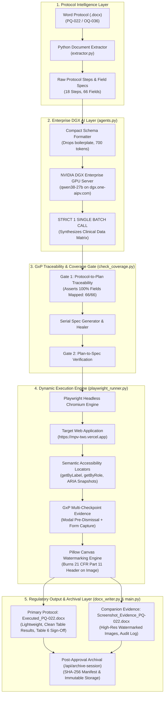

# Enterprise GxP Computer Systems Validation (CSV) Engine
## Architectural Blueprint, AI Prompt Engineering, & Strategic Scaling Roadmap

---

## 1. Executive Summary & Vision

This platform automates **Computer Systems Validation (CSV)** for life sciences and clinical applications (Pharmacovigilance, Clinical Trials, Regulatory Information Management), specifically targeting:
* **Operational Qualification (OQ):** Verifying functional specifications, boundary controls, and security limits derived from Functional Design Specifications (FDS).
* **Performance Qualification (PQ):** Verifying real-world clinical user workflows, adverse event intake, and data integrity derived from User Requirements Specifications (URS).

### The Paradigm Shift: Automation Script vs. Autonomous AI Validation Agent
* **Traditional Test Automation (Old):** Brittle Selenium/Cypress scripts hardcoded with fixed CSS/XPath selectors and static test strings (`"Alexander"`, `"Paracetamol"`). They break upon any minor UI refactor and require hundreds of hours of manual script maintenance.
* **Autonomous AI Validation Agent (This System):** Reads unstructured human-authored validation protocols in Microsoft Word (`.docx`), extracts test intents and required data fields, leverages a private company **NVIDIA DGX Qwen 27B** model in a strict single-batch call to synthesize realistic clinical data, and drives the browser dynamically using **semantic accessibility labels (`getByLabel`, `getByRole`)** rather than hardcoded IDs.

---

## 2. Complete End-to-End System Architecture



---

## 3. The DGX Qwen Prompt Engineering Specification

### 3.1 Design Philosophy: The "Clinical Data Contract"
To solve the token bottleneck on enterprise reasoning models (`nvidia/Qwen3.8-27B-NVFP4`), the prompt is **not** asked to generate raw Playwright code or figure out browser automation mechanics. Instead, it operates strictly as a **Clinical Pharmacovigilance Specialist** providing valid data values for exact keys extracted from the protocol.

* **Input Tokens Reduced:** From ~8,200 tokens (raw paragraphs + DOM dumps) down to **~730 tokens** (clean step-field dictionary).
* **Latency on DGX:** Reduced from **>180 seconds (timeouts)** down to **~45 seconds** for all 18 steps.

### 3.2 Verbatim System Prompt
```text
You are a Principal Pharmacovigilance Automation Quality Engineer and GxP Test Planner.
CRITICAL: Do not output reasoning or thinking. Output the final valid JSON immediately.
Synthesize realistic, valid GxP clinical values for all requested form fields according to MedDRA and ICH E2B standards.
Return STRICTLY a JSON object mapping each step_id to a dictionary of field names and values.
No markdown wrapping, no explanation.
```

### 3.3 Verbatim User Prompt Structure
```json
Protocol steps requiring test data:
[
  {
    "step_id": "TS1-S02",
    "screen": "User Authentication & Sign In",
    "fields": [
      "User Name",
      "Password",
      "Enterprise"
    ]
  },
  {
    "step_id": "TS1-S04",
    "screen": "General Information Setup",
    "fields": [
      "Case Classifications Code",
      "Case Intake Source Code",
      "Company Receipt Date",
      "Processing Center Received Date"
    ]
  },
  {
    "step_id": "TS1-S05",
    "screen": "Case Questionnaire Form",
    "fields": [
      "Field Type",
      "Question",
      "Response"
    ]
  },
  {
    "step_id": "TS1-S08",
    "screen": "Product Information Entry",
    "fields": [
      "Product Name",
      "Additional Drug Information"
    ]
  },
  {
    "step_id": "TS1-S10",
    "screen": "Event Information & MedDRA Coding",
    "fields": [
      "Reaction Or Event As Reported",
      "Reported Term",
      "Outcome",
      "Seriousness Criteria Hospitalization"
    ]
  }
]

Output JSON format:
{
  "TS1-S02": {"User Name": "sirihari.banda", "Password": "...", "Enterprise": "..."},
  "TS1-S04": {"Case Classifications Code": "ADVERSE_EVENT", ...},
  ...
}
```

### 3.4 Actual Output Generated by DGX Qwen
```json
{
  "TS1-S02": {
    "User Name": "sirihari.banda",
    "Password": "Clinevo@2024",
    "Enterprise": "Clinevo Pharma Inc."
  },
  "TS1-S04": {
    "Case Classifications Code": "ADVERSE_REACTION",
    "Case Intake Source Code": "EMAIL",
    "Company Receipt Date": "2024-11-15",
    "Processing Center Received Date": "2024-11-16"
  },
  "TS1-S05": {
    "Field Type": "TEXT",
    "Question": "Did the patient experience any prior episodes of similar symptoms?",
    "Response": "No prior adverse episodes reported by physician."
  },
  "TS1-S08": {
    "Product Name": "Paracetamol 500mg",
    "Additional Drug Information": "Administered orally once daily."
  },
  "TS1-S10": {
    "Reaction Or Event As Reported": "Severe throbbing headache following oral administration",
    "Reported Term": "Headache",
    "Outcome": "Recovered/Resolved",
    "Seriousness Criteria Hospitalization": "Yes"
  }
}
```

---

## 4. Deep Walkthrough: Complex Test Case Execution (Step TS1-S10)

| Phase | What Happens Under the Hood |
| :--- | :--- |
| **1. Protocol Ingestion** | Extractor identifies Step `TS1-S10`: Event Information Tab, Reported Term MedDRA search, Outcome dropdown, Seriousness toggle. |
| **2. Qwen Data Synthesis** | Qwen assigns MedDRA PT: `"Headache"`, Reaction: `"Severe throbbing headache"`, Outcome: `"Recovered/Resolved"`. |
| **3. Dynamic Navigation** | Playwright clicks `page.getByRole("tab", { name: "Event Information" })`. |
| **4. Form Population** | Playwright calls `page.getByLabel("Reaction Or Event As Reported").fill("Severe throbbing headache...")`. |
| **5. Modal Dialog Handling** | Clicks search icon next to Reported Term; waits for modal `role="dialog"`; types `"Headache"`; asserts row visible; **captures pre-dismissal screenshot**; clicks `Select`. |
| **6. Auto-Populate Verification** | Verifies Generic Name and SOC auto-populate in read-only state. |
| **7. Dropdown & Save** | Sets Outcome to `"Recovered/Resolved"`, Hospitalization to `"Yes"`, clicks `page.getByRole("button", { name: "Save" })`. |
| **8. 21 CFR Part 11 Stamp** | Burns top audit banner: `STEP: TS1-S10 \| REF: TMP-CASE-8231 \| 21 CFR PART 11 \| 22-OCT-2026 UTC \| USER: S.B.` |
| **9. Decoupled Routing** | Step `TS1-S10` status marked `PASS` in primary `.docx`; watermarked screenshot routed to `Screenshot_Evidence_PQ-022.docx`. |

---

## 5. Architectural Strengths vs. Prototype Pitfalls

| Dimension | Junior Prototype (What to Avoid) | Enterprise AI Engineering (This System) |
| :--- | :--- | :--- |
| **DOM Selectors** | Brittle CSS IDs (`#reporterFirstName`, `div > input:nth-child(2)`) | Semantic Accessibility Tree (`getByLabel`, `getByRole`, ARIA snapshots) |
| **LLM Responsibility** | Asking LLM to generate raw Playwright commands or coordinate 18 screens | Asking LLM strictly for domain clinical data synthesis via a typed contract |
| **Call Invariant** | Multiple sequential calls per step (slow, flakiness, token cost explosion) | **Strict 1 Single Batched Call** for the entire protocol document |
| **Evidence Storage** | Pasting 50 screenshots into the primary protocol (100MB bloated file) | **Decoupled Architecture:** Primary `.docx` is lightweight; separate companion dossier |
| **GxP Compliance** | Unstamped screenshots that fail FDA/EMA audits | Hard-coded **21 CFR Part 11 canvas watermarking** with UTC timestamp & tester ID |
| **Archival** | Files left loose in temp directories | **Post-approval SHA-256 cryptographic indexing** and immutable locking |

---

## 6. Strategic Roadmap: Elevating from "Automation Tool" to "Elite AI Engineering Product"

When brainstorming with Gemini or ChatGPT, use this framework to explore how to transition this architecture from an advanced tool into an industry-standard enterprise product:

### 6.1 Schema Enforcement via Constrained Decoding
* **Current State:** LLM returns JSON, and Python parses with `json.loads()`.
* **Elite AI Engineering:** Implement **Constrained Decoding** (using **Outlines**, **Instructor**, or **vLLM Guided Decoding / JSON Schema**). The DGX vLLM engine uses grammar-based sampling at the token level, mathematically guaranteeing 100% valid JSON conforming to the Pydantic schema with zero syntax errors.

### 6.2 LLM-as-a-Judge for AI Semantic Verification
* **Current State:** Pass/Fail is determined by UI error checking, network 200 OK, and banner verification.
* **Elite AI Engineering:** Introduce an **AI Semantic Judge**:
  - Compare the human-written **Expected Result** sentence (*"System prompts evaluator that medical review is required for serious reactions"*) against the live **Observed UI message** (*"Medical review mandatory for serious cases"*).
  - Qwen evaluates semantic equivalence, preventing false negatives caused by verbatim text discrepancies.

### 6.3 Retrieval-Augmented Generation (RAG) on Company SOPs & Clinical Dictionaries
* **Current State:** Qwen uses internal parametric knowledge to synthesize clinical data.
* **Elite AI Engineering:** Connect a local vector store (ChromaDB / Milvus) containing the company's:
  - Pharmacovigilance Standard Operating Procedures (SOPs).
  - Active Clinical Protocol Dossiers.
  - Standardized MedDRA / WHO-Drug dictionary terms.
  - The model retrieves real trial-specific compounds, dosages, and adverse events for testing.

### 6.4 Autonomous Self-Healing via ARIA Snapshots
* **Current State:** If an element is missing, it falls back to common selectors.
* **Elite AI Engineering:** If `getByLabel` fails, Playwright captures `page.aria_snapshot()` (50 lines of clean YAML). Qwen analyzes the YAML, identifies where the field was moved or renamed, and executes the self-healed click automatically while logging the healing action in the audit trail.

### 6.5 Automated Protocol Preparation (OQ from FDS, PQ from URS)
* **Current State:** Python template builds the 8 GxP tables from requirement dictionaries.
* **Elite AI Engineering:** Ingest raw enterprise Word/PDF documents of Functional Design Specifications (FDS) and User Requirements Specifications (URS). Qwen extracts user journeys, boundary conditions, and generates complete, executable OQ and PQ test protocols with a 100% complete **Requirements Traceability Matrix (RTM)**.

---

## 7. Enterprise & Organizational Alignment (Life Sciences & Pharma)

```
┌────────────────────────────────────────────────────────────────────────┐
│                   ENTERPRISE DATA GOVERNANCE BOUNDARY                  │
│                                                                        │
│  [Local Workstation] ──(Encrypted HTTPS)──> [Company DGX GPU Server]   │
│  • Word Protocol Ingestion                   • vLLM Inference Engine   │
│  • Headless Playwright                       • Qwen 27B Model          │
│  • Canvas Timestamping                       • ZERO Cloud Egress       │
│  • Decoupled Evidence Docs                   • 100% Data Privacy       │
│                                                                        │
│  COMPLIANCE: 21 CFR Part 11 | EU Annex 11 | HIPAA | GAMP 5 Category 4  │
└────────────────────────────────────────────────────────────────────────┘
```

1. **Why the NVIDIA DGX Server is Mandatory for Pharma:**
   - Patient privacy (HIPAA) and proprietary trial molecules cannot be transmitted to external LLM APIs (OpenAI, Anthropic). Running on the internal DGX ensures zero data egress.
2. **Audit Readiness (FDA / EMA Inspections):**
   - The decoupled companion evidence document pattern allows QA leads to archive lightweight signed protocols for executive review while preserving high-resolution forensic evidence for regulatory inspectors.
3. **Cryptographic Integrity:**
   - Generating `manifest.sha256` satisfies FDA 21 CFR Part 11.10(e) requirements for computerized system audit trails and record immutability.

---

## 8. Meta-Prompts to Brainstorm with Gemini / ChatGPT

Copy and paste these exact prompts into ChatGPT or Gemini to explore enhancements with the AI:

### Prompt A: Architecture & Reliability Review
> *"I have built an enterprise GxP Computer Systems Validation (CSV) automation platform for Pharmacovigilance. It uses a Python extractor for Word documents, an internal NVIDIA DGX server running Qwen 27B for single-batch clinical data planning, dynamic Playwright with user-facing accessibility locators (`getByLabel`, `getByRole`), 21 CFR Part 11 canvas timestamp watermarking, and decoupled companion evidence documents. Review Section 2 and Section 5 of this architectural blueprint. What architectural patterns would you introduce to ensure five-nines (99.999%) reliability across 500+ heterogeneous clinical web applications?"*

### Prompt B: Constrained Decoding & Prompt Optimization
> *"Review Section 3 (Prompt Engineering Specification). The current model is a 27B parameter reasoning model on a private DGX server. How can I implement grammar-constrained sampling (e.g., using Outlines or vLLM guided JSON schema) to completely eliminate JSON parsing failures while capping reasoning tokens to keep latency under 10 seconds?"*

### Prompt C: AI-as-a-Judge for Validation Pass/Fail
> *"Review Section 6.2 (LLM-as-a-Judge for Semantic Verification). Design a formal prompt and Pydantic schema for an AI evaluator that compares human-written protocol 'Expected Results' against live scraped web messages. Ensure the evaluation is deterministic, provides an audit-compliant rationale, and handles negative test cases (where an error message is expected)."*

### Prompt D: OQ/PQ Protocol Generation from URS & FDS
> *"Review Section 6.5. In Computer Systems Validation (GAMP 5), OQ derives from FDS (Functional Design Specifications) and PQ derives from URS (User Requirements Specifications). How can I design a multi-agent RAG workflow that reads a 50-page enterprise URS PDF, extracts all user requirements, and outputs a complete, ready-to-execute PQ validation protocol with an authoritative Requirements Traceability Matrix (RTM)?"*
